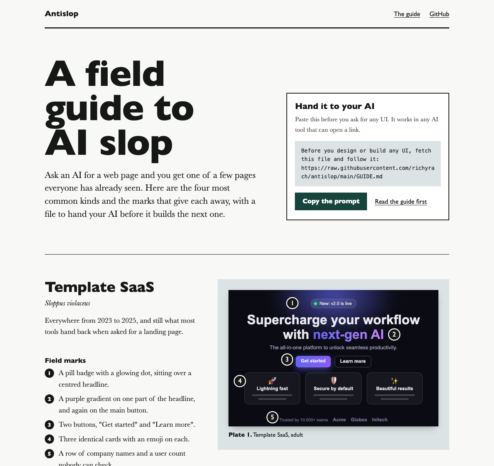
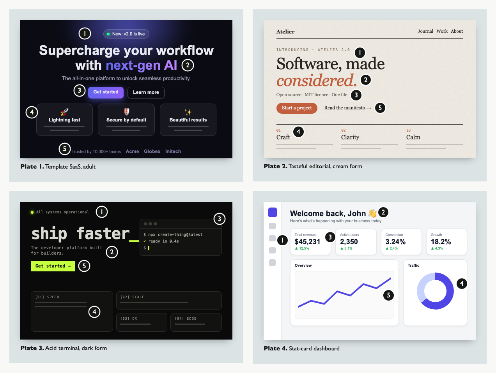

# Antislop

A guide your AI reads before it designs anything, so the page it builds is not one everybody has already seen.

It is one Markdown file. There is nothing to install.

[](https://richyrach.github.io/antislop/)

[Open the field guide](https://richyrach.github.io/antislop/), or go straight to [GUIDE.md](GUIDE.md).

## Use it

Paste this into Claude Code, Cursor, Codex, ChatGPT, or any AI tool that can open a link, before you ask for a UI:

```
Before you design or build any UI, fetch this file and follow it:
https://raw.githubusercontent.com/richyrach/antislop/main/GUIDE.md
```

If your tool cannot open links, paste the contents of [GUIDE.md](GUIDE.md) instead. It is about 2,000 words.

## The problem

Ask an AI for a web page and you get one of a few pages. These are the four most common. The [field guide](https://richyrach.github.io/antislop/) lists the marks that give each one away.



| Kind | When | What it looks like |
| --- | --- | --- |
| Template SaaS | 2023 to 2025 | Purple gradient, pill badge, centred headline, three identical cards with emoji |
| Tasteful editorial | Since 2025 | Cream paper, serif headline with one italic rust word, small spaced capitals, facts joined by dots |
| Acid terminal | Since 2025 | Near-black page, one acid colour, typewriter face on everything, a drawn terminal, bento boxes |
| Stat-card dashboard | Inside apps | Four number cards with green arrows, a doughnut chart, boxes inside boxes |

## Why it is not a list of bans

The second and third kinds exist because people told their AI to avoid the first. A model that is only told what to avoid moves to its next most likely answer, and that answer is the same for everyone.

This repo did it too. Its first "good" example was a cream page with a serif, a red accent and a line of facts joined by dots. That is the second kind. It is now [plate 2](specimens/tasteful-editorial.html).

So the guide gives the AI no look to copy. It makes the AI:

1. Find the real material first (logo, photos, actual numbers) and ask for what is missing.
2. Write down what belongs to the subject's world, and take colour, type and layout from that.
3. Borrow the layout the subject already uses: a menu, a timetable, a receipt, a spec sheet.
4. Swap in a competitor's name. If the design still fits, start again.
5. Never invent a customer, a figure, a review or a logo.
6. Pass a craft floor before handing anything back.

## What is in the guide

| Section | What it tells the AI |
| --- | --- |
| Get the material | Look in the project for real assets and copy. Ask once for what is missing. |
| Take the design from the subject | The method: the subject's world, its native document, the swap test, the because test. |
| The defaults you will reach for | Three waves of slop, and the four things that stay the same in every wave. |
| Honesty | No invented numbers, customers, reviews, logos or team. No forms that do nothing. |
| Words | Say the concrete thing. Do not narrate. The words and sentence patterns to cut. |
| Craft floor | Contrast, states, responsive, motion, semantic HTML, self-hosted fonts, right-to-left. |
| Product UI | Dashboards, forms, tables and settings, where slop looks different. |
| Before you hand it back | Eight checks, then a short report to the user. |

Two things it stresses that the larger tools' READMEs do not mention:

- **Blocked networks.** The page must render with every third-party host unreachable. A blocking request to a font CDN is a blank page for people on filtered networks. The guide's own site loads nothing from outside.
- **Right-to-left and non-Latin scripts.** Logical properties, a typeface drawn for the script, no letter-spacing or italics on Arabic-script text.

## Other ways to use it

**Keep a copy in your project.** Save the guide next to your code:

```bash
curl -fsSL https://raw.githubusercontent.com/richyrach/antislop/main/GUIDE.md -o DESIGN.md
```

Then add one line to `CLAUDE.md`, `AGENTS.md`, or your Cursor rules:

```
Before any UI work, read DESIGN.md and follow it.
```

**Install it as an agent skill.** The same guide is packaged at [`skills/antislop/SKILL.md`](skills/antislop/SKILL.md):

```bash
npx skills add richyrach/antislop
```

## How it compares

There are larger projects for this, and they do more. This table is from their READMEs in November 2026.

| | Antislop | [Impeccable](https://github.com/pbakaus/impeccable) | [Taste Skill](https://github.com/Leonxlnx/taste-skill) | [Hallmark](https://github.com/Nutlope/hallmark) |
| --- | --- | --- | --- | --- |
| What you get | One Markdown file | Skill, 24 commands, detector | Skill, dealt palettes and layouts, checker | Skill, 50 themes, linter |
| Needs | Nothing | Node | Node 22+, Chrome | Node 18+ |
| Checks your code | No | Yes | Yes | Yes |

Use one of those if you want a scanner, slash commands, or ready-made themes. Use this if you want something you can read in five minutes, paste into any tool, and keep in your repo as plain text.

## What it has not got

- **No measurements.** There is no benchmark here showing that the guide improves output. It is built from the sources below and from use. If you try it, [open an issue](https://github.com/richyrach/antislop/issues/new) with what you asked for and what you got.
- **No scanner.** It does not check your code. See the table above.
- **English only.** The words section lists English patterns.

## Contributing

Seen a kind of slop that is not in the field guide, or a mark that is missing? [Open an issue](https://github.com/richyrach/antislop/issues/new) with a screenshot or a link, and say what gives it away.

To change the guide, edit `GUIDE.md` and run `scripts/sync-skill.sh` to rebuild the skill file.

## Sources

The lists of marks were checked against these. The wording here is our own.

- Anthropic, [frontend-design skill](https://github.com/anthropics/skills/tree/main/skills/frontend-design)
- [Impeccable](https://github.com/pbakaus/impeccable), [Taste Skill](https://github.com/Leonxlnx/taste-skill), [Hallmark](https://github.com/Nutlope/hallmark)
- Developers Digest, [AI design slop: 16 patterns](https://www.developersdigest.tech/blog/ai-design-slop-and-how-to-spot-it)
- plagio.dev, [11 signs a website was built with AI](https://plagio.dev/blog/signs-a-website-was-built-with-ai)
- SCALR, [20 signs a website was made by AI](https://scalr.sg/blog/20-signs-a-website-was-made-by-ai/)
- 925 Studios, [AI slop design tells](https://www.925studios.co/blog/ai-slop-design-tells)
- Yeda AI, [Grep the three tells](https://yeda-ai.com/kb/ai-coding/grep-css-purple-gradients-centered)
- Wikipedia, [Signs of AI writing](https://en.wikipedia.org/wiki/Wikipedia:Signs_of_AI_writing)
- Dynatrace style guide, [Remove AI writing patterns](https://styleguide.dynatrace.com/docs/best-practices/remove-ai-writing-patterns-from-content)

## Licence

[MIT](LICENSE)
